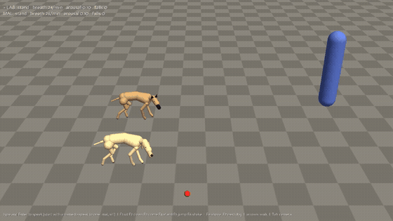

# whole-dog

**A physics-simulated dog that decides for itself, falls for real, and gets back up.**



*Simulation only (MuJoCo, rendered in Panda3D). Two dogs, a Labrador and a Malinois, share one physics world. Each has its own brain, hears words, and drives a 54-actuator, 28 kg muscle-driven body through a learned tracking policy.*

whole-dog is a research build of a game dog that people who know dogs would accept as alive and as a particular dog. It takes requests and keeps the final say, does what real dogs do (retrieve, follow, sit, lie down, jump, shake, rest), falls when physics says so, and runs in real time on one CPU core.

> **Where this is going:** [VISION.md](VISION.md) describes the long-term program: a complete behavioral and biomechanical model of one specific animal, learned from everyday video, as a path to embodied cognition models and digital twins of living beings.

## What runs today

```
 words ("come", "platz", "fetch the toy")
   │
   ▼
 grammar ── 316-entry behavior lexicon compiled into links priced in bits, reflexive vs planned
   │
   ▼
 brain ──── drives (arousal, breath, fatigue), takes requests, may decline
   │
   ▼
 motion matcher ── changes regime only through transitions seen in real dog motion;
   │               plans routes over that transition graph (side → belly → stand → walk)
   ▼
 tracking policy (RL) ── muscles with activation lag, ligament-limited joints, dog strength
   │
   ▼
 MuJoCo body ── 54 actuators, passive tail, 28 kg
   │
   └── fall detector ─► scramble_up reflex policy ─► re-sync to the nearest lying frame ─► plan again
```

| result | number | where |
|---|---|---|
| One tracking policy for the whole flat motion library, full 6 s episodes held | 78% of starts; 85% after fine-tuning on the matcher's own output | [RESULTS.md](RESULTS.md) |
| Capture completion with dog-strength muscles (vs. the earlier, over-strong body) | 93.5% (95.3%) | [RESULTS.md](RESULTS.md) |
| `scramble_up` reflex: on its feet from side or back | 100% of trials, under 0.5 s | [body/train/dog_right.py](body/train/dog_right.py) |
| Whole online loop (brain, words, matcher, body, reflex, fall logic) on one CPU core | 5.1 ms per 20 ms step | [body/train/dog_cpu.py](body/train/dog_cpu.py) |
| CPU policy and observation vs. the JAX training environment | equal to 4 × 10⁻⁷ | [body/train/parity_cpu.py](body/train/parity_cpu.py) |
| Native game runtime (Windows, one core) | 2.8 ms per step; two dogs 6.1 ms | [game/dog_runtime.py](game/dog_runtime.py) |
| Social play, 50 one-minute sessions per dog | Lab 0.24 falls/min, Malinois 0.12; every fall recovered (median 0.94 s) | [RESULTS.md](RESULTS.md) |
| Behavior lexicon written from text, checked against real motion | allows 34% of possible regime changes but covers 78% of those in the capture (random graphs: 33%) | [dog-lexicon/](dog-lexicon/README.md) |

Negative and unresolved results are kept, not hidden. For example: "the dog falls when forced through a forbidden transition but not when routed" was **not** shown once fall detection was corrected; a Brax auto-reset bug that left the reference clock behind was found and fixed. See [RESULTS.md](RESULTS.md), the full lab notebook (newest first).

## Simulation renders

All renders are simulation output. No real dog footage is included.

| render | what it shows |
|---|---|
| [media/first_slice.gif](media/first_slice.gif), [dog/first_slice_physics.mp4](dog/first_slice_physics.mp4) | The Malinois's first slice of life, decided online by her brain, fully in physics, no falls |
| [game/demo_both.mp4](game/demo_both.mp4) | Both dogs in one world, each with its own brain |
| [game/demo_mal_jump.mp4](game/demo_mal_jump.mp4) | "platz", then an insisted "jump": she springs, falls, the reflex has her up within a second |
| [game/demo_lab_beer.mp4](game/demo_lab_beer.mp4) | "go to the fridge door and fetch me a beer", parsed by the grammar and carried out |
| [game/demo_play.mp4](game/demo_play.mp4) | Free play in the first playable |
| [dog/scramble_up_compare.mp4](dog/scramble_up_compare.mp4), [dog/scramble_up_strict.mp4](dog/scramble_up_strict.mp4) | Getting-up reflex compared across body strengths |
| [dog/words_physics.mp4](dog/words_physics.mp4), [dog/words_dog_strength_reflex.mp4](dog/words_dog_strength_reflex.mp4) | New motion from new sentences, in physics |
| [body/first_slice_mm.mp4](body/first_slice_mm.mp4) | Motion-matcher output before physics |

## Repository map

| folder | what |
|---|---|
| [SYSTEM.md](SYSTEM.md) | Every layer the whole dog needs, what is solved elsewhere, what exists here |
| [REQUIREMENTS.md](REQUIREMENTS.md), [requirements.csv](requirements.csv) | Requirements with stable IDs, verification methods and evidence; tests carry the IDs |
| [decisions/](decisions/) | Decision records with fixed criteria and an independent adversarial review |
| [dog/](dog/) | Grammar, brain, link tests, first slice |
| [dog-lexicon/](dog-lexicon/README.md) | 316 body entries, 39 sequences, 79 handler requests, posture graph; reduced to 84 modes on 16 body parts; blind cross-model checks; [adversarial review](dog-lexicon/rivals/README.md) |
| [body/](body/) | MuJoCo models (anatomical joints, ligaments, muscles), motion library tools, motion matcher |
| [body/train/](body/train/) | Brax / MuJoCo Warp training (tracker, reflex), CPU export, parity checks, online loop |
| [game/](game/) | Panda3D first playable and the JAX-free runtime |
| [footage/](footage/) | Phone-video pipeline: DeepLabCut SuperAnimal tracking, normalization, gait and reaction features, regime and identity learners |
| [identity-test/](identity-test/README.md) | Browser test: can people who know a dog pick it out from movement dots alone? Pre-registered statistics |
| [research/](research/) | Prior-art and model-building research prompts and answers |

## Quickstart

**CPU only (tests, grammar, lexicon checks, body models):**

```bash
pip install -r requirements-cpu.txt
python -m pytest -q tests                       # body compiles and steps, grammar, lexicon
(cd footage && python -m pytest -q tests)       # footage pipeline unit tests
python dog/grammar.py --dog mal generate        # sentences the Malinois's grammar produces
python -c "import mujoco, mujoco.viewer as v; v.launch(mujoco.MjModel.from_xml_path('body/dog_anat.xml'))"
```

**Training (GPU):** the training stack (JAX with CUDA 12, MuJoCo MJX / Warp, Brax, MuJoCo Playground) installs with [body/wsl_install.sh](body/wsl_install.sh) and was developed on one RTX 3090 under WSL2 ([PERFORMANCE_NOTES_3090.md](PERFORMANCE_NOTES_3090.md)). Training needs the motion-capture references, which are not included (see below). Set `DOG_WORK` to where runs and references should live (default `./runs`).

**The playable game** (`python game/dog_game.py --dogs lab,mal`) and the online loop need trained policies, which are not included.

## What is not in this repository

**Real dog footage, raw data sources and trained weights are not included. They are available on request.**

- Real dog footage: none. Every image and video here is simulation output.
- Motion capture: training used the public dog motion-capture dataset released with *Mode-Adaptive Neural Networks for Quadruped Motion Control* (Zhang, Starke, Komura, Saito; SIGGRAPH 2018), licensed CC BY-NC 4.0. It is not redistributed here; obtain it from its authors' release. Joint ranges in the anatomical body were computed from it as summary statistics.
- Trained policies and checkpoints: not included, because they are derived from the non-commercial dataset.
- Raw LLM outputs from the lexicon checks: not included.

## Tests

| suite | runs | result |
|---|---|---|
| `tests/test_smoke.py` | body models compile and step 1 s; 54 actuators; 28 kg; lexicon recipes check; grammar generates | 5 pass |
| `footage/tests` | dot rendering, normalization, gap filling, audio onsets (requirement IDs in test names) | 10 pass |
| `identity-test` (`node --test`) | trial planner: one target per trial, same-breed foils, no reused clips, balanced positions, reproducible | 6 pass |
| GPU tests in `body/train/` | need a GPU and references | not run in CI |

## License

MIT for all code. See [LICENSE](LICENSE). Third-party data keeps its own license. Author: Alexander Derkatsch.
